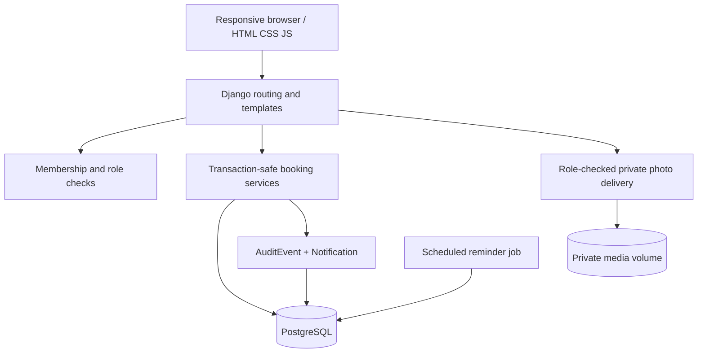

# System design

KINETRA is a **server-rendered modular Django monolith** with a PostgreSQL database. HTML, CSS and small Vanilla JS modules provide the interface. Django view functions are thin controllers and `exchange/services.py` holds transaction-bound domain operations.

## Role boundaries

| Action | Borrower | Owner | Manager | Org admin |
|---|---|---|---|---|
| Browse active public resources | Yes | Yes | Yes | Yes |
| Request an eligible resource | Verified membership | Verified membership | Verified membership | Verified membership |
| Create a resource | No | Yes | Yes | Yes |
| Approve a booking | No | Own resources only | Within organisation | Within organisation |
| Report before/after condition | Own booking | Only when borrower | Only when borrower | Only when borrower |
| Confirm physical handover | No | Own resources | Within organisation | Within organisation |
| Verify members | No | No | Limited role grants | All organisation roles |
| Verify training | No | No | Yes | Yes |
| Read organisation-wide audit | No | No | Yes | Yes |
| Review an incident | Reporter | Own resources | Within organisation | Within organisation |

A reviewer cannot confirm their own booking, and cannot approve their own booking. These are service-level checks.

## Booking lifecycle

`requested → approved → checkin_pending → active → return_pending → completed`

Other branches: `requested → waitlisted`, `requested/waitlisted → rejected`, and `requested/waitlisted/approved → cancelled`. A waitlisted booking can be promoted to `requested` for **human review** after the slot clears. No automatic access grants.

Approval is serialised by `SELECT ... FOR UPDATE` on the resource row, followed by an overlap check while holding the lock. All state changes and audit events run inside a database transaction. This depends on PostgreSQL (SQLite dev smoke mode is **not a concurrency test**).

## Fairness

The policy caps open bookings per user (organisation setting) and confirmed weekly hours per resource. When a slot opens, eligible waitlisted users are ordered by their historical confirmed usage over the organisation's fairness window, then request timestamp, then booking id. The best candidate is returned to pending management review. This rule is explainable and deterministic but is not an exhaustive equity policy.

## Security and tenant isolation

Every privileged action resolves a verified organisation membership, then checks its permitted roles, and for owners their actual resource ownership. Authenticated users only access bookings they borrowed or may review. Condition evidence uses an authenticated download endpoint with access checks. Do not map `/media/` to public CDN or reverse proxy routing in a real deployment.

## Extensibility

Use separate Django apps when domains materially outgrow this initial implementation. Future payment processing, institutional SSO, object storage, queue workers, APIs and push notifications are **not currently implemented**. Add them behind stable domain services when required.
